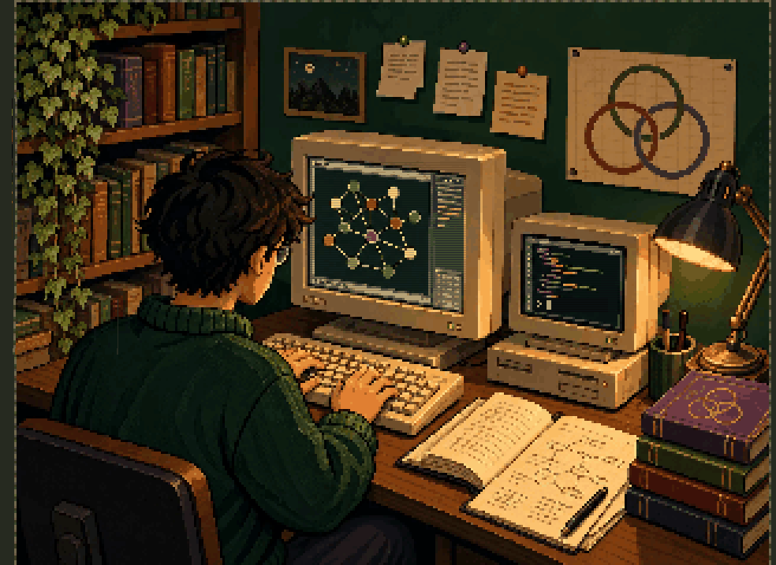

  

<h1 align="center">Hola, soy Aldo.G</h1>

  Proyectos de datos y web con Python, TypeScript y Next.js. 
  Aquí están mis repositorios públicos, con su stack y su sitio publicado.

  

### Repositorios

| Repo | Stack | Sitio |
|---|---|---|
| [copiloto-comercial](https://github.com/Aldo14G/copiloto-comercial) | Python · Streamlit · Claude | [copiloto-comercial-aldo.streamlit.app](https://copiloto-comercial-aldo.streamlit.app/) |
| [DatosAbiertos2026-v3](https://github.com/Aldo14G/DatosAbiertos2026-v3) | Python · pandas · Streamlit · Plotly | [datos-abiertos-nl-2026.web.app](https://datos-abiertos-nl-2026.web.app/) |
| [Itinerante](https://github.com/Aldo14G/Itinerante) | Next.js · Firebase Data Connect · Genkit | — |
| [LangGraph-](https://github.com/Aldo14G/LangGraph-) | Python · LangGraph · [plantilla LangChain](https://github.com/langchain-ai/data-enrichment) | — |

### Stack

              

Python · TypeScript · JavaScript · SQL 
Next.js · React · Firebase · Supabase · PostgreSQL 
pandas · Power BI · LaTeX · Claude Code

### Actividad

  <picture>
    <source media="(prefers-color-scheme: dark)" srcset="https://github-readme-stats.vercel.app/api?username=aldo14g&show_icons=true&hide_border=true&cache_seconds=86400&disable_animations=true&bg_color=0d1117&title_color=e8a33d&icon_color=7fb069&text_color=c9d1d9" />
    <source media="(prefers-color-scheme: light)" srcset="https://github-readme-stats.vercel.app/api?username=aldo14g&show_icons=true&hide_border=true&cache_seconds=86400&disable_animations=true&bg_color=ffffff&title_color=b7791f&icon_color=2f855a&text_color=24292f" />
    
  </picture>
  <picture>
    <source media="(prefers-color-scheme: dark)" srcset="https://streak-stats.demolab.com/?user=aldo14g&hide_border=true&disable_animations=true&background=0d1117&ring=e8a33d&fire=e8a33d&currStreakNum=c9d1d9&sideNums=c9d1d9&currStreakLabel=e8a33d&sideLabels=7fb069&dates=8b949e&stroke=30363d" />
    <source media="(prefers-color-scheme: light)" srcset="https://streak-stats.demolab.com/?user=aldo14g&hide_border=true&disable_animations=true&background=ffffff&ring=b7791f&fire=b7791f&currStreakNum=24292f&sideNums=24292f&currStreakLabel=b7791f&sideLabels=2f855a&dates=57606a&stroke=d0d7de" />
    
  </picture>

  <picture>
    <source media="(prefers-color-scheme: dark)" srcset="https://github-readme-stats.vercel.app/api/top-langs/?username=aldo14g&layout=compact&hide_border=true&langs_count=8&cache_seconds=86400&disable_animations=true&bg_color=0d1117&title_color=e8a33d&icon_color=7fb069&text_color=c9d1d9" />
    <source media="(prefers-color-scheme: light)" srcset="https://github-readme-stats.vercel.app/api/top-langs/?username=aldo14g&layout=compact&hide_border=true&langs_count=8&cache_seconds=86400&disable_animations=true&bg_color=ffffff&title_color=b7791f&icon_color=2f855a&text_color=24292f" />
    
  </picture>

  <picture>
    <source media="(prefers-color-scheme: dark)" srcset="https://raw.githubusercontent.com/Aldo14G/Aldo14G/output/github-snake-dark.svg" />
    <source media="(prefers-color-scheme: light)" srcset="https://raw.githubusercontent.com/Aldo14G/Aldo14G/output/github-snake.svg" />
    
  </picture>

